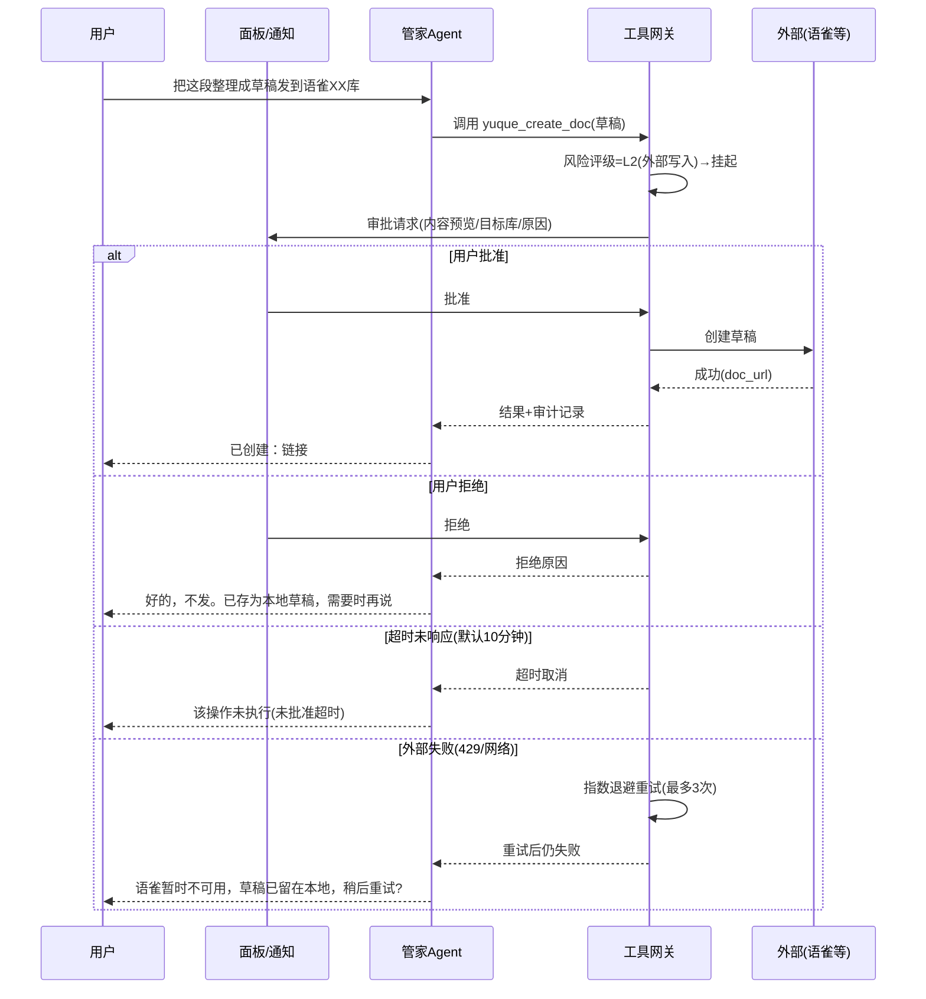
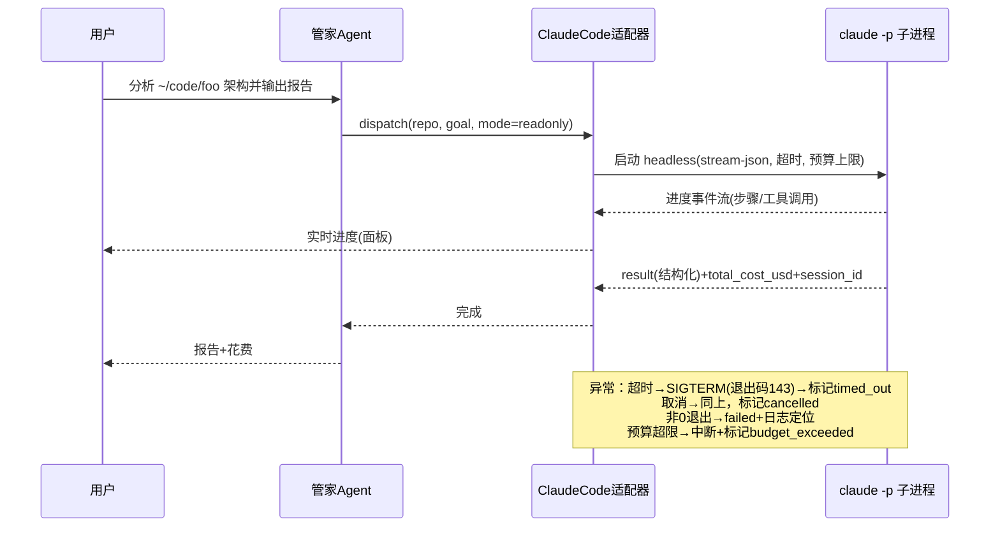

# Aster 产品需求文档（PRD）

- 版本：v0.1（设计阶段草案，待用户评审）
- 日期：2026-11-03
- 状态：**仅文档阶段，未获批准前不写任何业务代码**

---

## 1. 项目概述

### 1.1 名字与寓意

**Aster**（紫菀 / 星形花）——星辰、指引、始终陪伴。

### 1.2 一句话定位

一个运行在 macOS 上的本地优先（local-first）个人 AI 管家：桌面悬浮伙伴 + 聊天/任务/知识库面板 + 长期个人记忆 + 自动化任务调度，并深度集成语雀（知识管理）与 Claude Code（编程代理）。

### 1.3 愿景

- 不是"又一个聊天客户端"，而是**长期陪伴的数字管家**：记得住事、管得住日程、查得到知识、派得动编程 Agent。
- 本地优先：个人数据（记忆、待办、知识索引、任务记录）默认存本机 SQLite / Markdown，密钥进 macOS 钥匙串，外部服务按需接入。
- 诚实可靠：对能力边界诚实（关机不运行、休眠不调度），高风险动作必须经过用户确认，全程留审计。

## 2. 目标用户与使用环境

| 项 | 说明 |
|---|---|
| 用户 | 单人（项目主人本人），开发者背景 |
| 设备 | MacBook（Apple Silicon M4），macOS 14+ |
| 已有工具 | Claude Code（CLI + VS Code 插件）、语雀、VS Code |
| 使用模式 | 全天挂机运行，开机自启；随时唤起，长时间对话较少、碎片化指令多 |
| 网络环境 | 可访问公网 API（Anthropic、语雀）；部分域名抓取受限（本项目调研中 github.com 等曾被拦截，需代理/镜像备选） |

**单一用户是重要约束**：无多租户、无账号体系、无服务端并发压力，架构应以"单机单用户"为前提控制复杂度。

## 3. 核心价值主张（为什么自己造）

1. **记忆是自己的**：聊天记录、个人记忆、知识索引全部本地，不进任何第三方云端（除显式调用的模型 API 与语雀）。
2. **把散落的 AI 能力收拢到一个入口**：聊天问答、待办管理、知识检索、语雀读写、编程任务派发，统一由一个管家 Agent 调度。
3. **自动化但有缰绳**：低风险动作自动执行，高风险动作必须人工确认；每次工具调用可审计、可回滚、可紧急停止。
4. **陪伴感**：悬浮球/角色常驻桌面，有状态反馈（空闲/思考/执行/等待确认/成功/失败），不是冷冰冰的后台进程。

## 4. 用户场景与用户故事

### 场景 A：日常陪伴问答（P0）

> US-A1：作为用户，我想随时点开悬浮球问一句"帮我总结下这段话/提醒我 15 分钟后看烤箱"，立刻得到回答或已登记的提醒，而不用打开浏览器。
> US-A2：作为用户，我问"上次我们讨论 X 结论是什么"，Aster 能从个人记忆/历史会话中检索出来并给出处。

### 场景 B：个人待办与主动提醒（P0）

> US-B1：作为用户，我想用自然语言或表单添加待办（"周五前把报销单交了"，优先级高），Aster 解析入库并到点提醒。
> US-B2：作为用户，我想设置重复任务（"每天早上 9 点看一次新闻摘要"），Aster 按计划执行并把结果推给我。
> US-B3：作为用户，我希望 Aster 在我打开面板时主动展示"今日待办 + 过期事项 + 建议的下一步"。
> US-B4：作为用户，我要明确知道：合盖休眠/关机时提醒不会触发，唤醒/重启后会按策略补提醒或标记错过——**不得被欺骗**。

### 场景 C：知识管理（P1）

> US-C1：作为用户，我想丢给 Aster 一篇文档/链接/笔记，它归档进本地知识库（Markdown），自动打标签、生成摘要，支持全文与语义搜索。
> US-C2：作为用户，我想搜"之前存的那篇讲 SQLite 优化的文章"，得到知识库 + 语雀的联合结果，去重后展示出处。
> US-C3：作为用户，重复导入同一内容时，Aster 应识别并提示合并/跳过，而不是存两份。

### 场景 D：语雀集成（P1）

> US-D1：作为用户，我想让 Aster 直接搜我语雀知识库里的文档并给出摘要与链接。
> US-D2：作为用户，我说"把这段整理成一篇草稿发到我语雀的 XX 知识库"，Aster 生成草稿、**展示预览、经我确认后**才创建/更新语雀文档。
> US-D3：作为用户，我希望语雀 Token 只存在钥匙串里，永不出现在代码、日志或知识文档中。

### 场景 E：编程代理（Claude Code 集成，P1）

> US-E1：作为用户，我想说"分析一下 ~/code/foo 这个仓库的架构，输出到面板"，Aster 以 headless 模式派发给 Claude Code，实时显示进度，结束后给我结构化结果。
> US-E2：作为用户，我想派发"给 X 加个功能并写测试"这类改动任务，但默认只授权指定目录，目录外的写操作要经过我确认。
> US-E3：作为用户，我想随时取消一个跑偏的编程任务，并保留完整日志与退出状态供复盘。
> US-E4：作为用户，我需要区分"独立 CLI 会话"与"接管我正在用的 VS Code 插件会话"——MVP 只做前者，不碰我的交互会话。

### 场景 F：记忆沉淀（P0 基础 / P1 完善）

> US-F1：作为用户，我希望 Aster 记住"我偏好中文回复""我的项目叫 Aster"这类稳定事实，下次对话直接生效。
> US-F2：作为用户，我不希望每句闲聊都被塞进记忆库——只有明确确认或高置信度的稳定信息才入库。
> US-F3：作为用户，我能查看、编辑、删除任何一条记忆，并为记忆设置有效期（如"这周在出差"过期自动失效）。

### 场景 G：多 Agent 协作（P2）

> US-G1：作为用户，我希望复杂任务自动拆给 管家/知识/编程/研究/复核 等角色，各自执行后汇总，而不是一个大 prompt 硬扛。

## 5. 功能需求

> 编号规则：FR-模块-序号。优先级 P0（MVP 必须）/ P1（第二阶段）/ P2（远期）。

### 5.1 桌面伙伴与交互（FR-UI）

| 编号 | 需求 | 优先级 |
|---|---|---|
| FR-UI-1 | 悬浮球：透明背景、始终置顶、可拖动、可点击穿透切换、双击唤起主面板 | P0 |
| FR-UI-2 | 状态动画：空闲/思考/执行任务/等待确认/成功/失败 至少 6 态，MVP 用静态帧/Lottie，P2 升级 | P0 |
| FR-UI-3 | 主面板：聊天、任务、知识库、设置四个标签页；可展开/收起/贴边隐藏 | P0 |
| FR-UI-4 | 菜单栏托盘：状态显示、快捷开关（暂停自动化/退出）、最近任务 | P0 |
| FR-UI-5 | 系统通知：提醒、任务完成、需要确认时弹 macOS 通知，可点击跳转 | P0 |
| FR-UI-6 | 开机自启、无 Dock 图标（后台形态）运行 | P0 |
| FR-UI-7 | 审批弹层：高风险操作展示"动作+目标+原因+影响"，一键批准/拒绝 | P0 |

### 5.2 管家 Agent 与对话（FR-CHAT）

| 编号 | 需求 | 优先级 |
|---|---|---|
| FR-CHAT-1 | 多轮对话，流式输出；会话与消息持久化、可回看 | P0 |
| FR-CHAT-2 | 管家 Agent 原生工具循环（非框架），工具调用过程对用户可见 | P0 |
| FR-CHAT-3 | 模型接入层：主用 Anthropic API，可配置多 provider 降级切换 | P0 |
| FR-CHAT-4 | 上下文组装：系统提示 + 活跃记忆注入 + 检索结果注入，带预算控制 | P0 |
| FR-CHAT-5 | 会话摘要与沉淀：会话结束后提取候选记忆，用户确认入库 | P1 |

### 5.3 记忆系统（FR-MEM）

| 编号 | 需求 | 优先级 |
|---|---|---|
| FR-MEM-1 | 记忆分类：个人偏好 / 事实 / 目标 / 关系（人/项目）/ 临时状态（带有效期） | P0 |
| FR-MEM-2 | 记忆 CRUD + 来源追溯（哪次会话/哪个文件产生）+ 置信度 | P0 |
| FR-MEM-3 | 记忆检索：关键词 + 向量双路，注入前按相关度与新鲜度排序 | P1 |
| FR-MEM-4 | 去重与冲突：语义相近的新记忆提示合并/替代，保留被替代历史 | P1 |
| FR-MEM-5 | 记忆与知识库、Skills、Prompts、Agent 配置、任务记录**分开存储**，不混为一谈 | P0 |

### 5.4 知识库（FR-KB）

| 编号 | 需求 | 优先级 |
|---|---|---|
| FR-KB-1 | 本地知识库：Markdown 文件树为本体，SQLite 建 FTS5 全文索引 | P1 |
| FR-KB-2 | 语义向量检索（sqlite-vec），与全文检索融合（混合检索）| P1 |
| FR-KB-3 | 导入：手动拖入 / 粘贴文本 /（P2 网页抓取），自动摘要、打标签 | P1 |
| FR-KB-4 | 去重：内容哈希 + 语义相似度双校验 | P1 |
| FR-KB-5 | 与语雀知识联合搜索（结果带来源标记） | P1 |

### 5.5 语雀集成（FR-YUQUE）

> **状态更新（2026-11-03）**：官方 MCP/开放 API 需语雀**超级会员**，用户暂无——本节全部需求降级为"可选，待会员变更后启用"，不进入主线阶段排期。架构上保留 `YuqueAdapter` 接口与 L2 审批设计。

| 编号 | 需求 | 优先级 |
|---|---|---|
| FR-YUQUE-1 | 授权管理：Token 存钥匙串；连接测试；失败重试与明确报错 | P1 |
| FR-YUQUE-2 | 搜索与读取语雀文档（官方 API / 官方 MCP） | P1 |
| FR-YUQUE-3 | 创建/更新语雀文档：**必须先出预览、经用户批准**；草稿优先 | P1 |
| FR-YUQUE-4 | 本地↔语雀 双向同步配置（按文档/知识库粒度，冲突策略可选） | P2 |
| FR-YUQUE-5 | 限流（429）退避重试、废弃接口（410）告警 | P1 |

### 5.6 编程代理集成（FR-CODE）

| 编号 | 需求 | 优先级 |
|---|---|---|
| FR-CODE-1 | 以 headless 子进程派发任务：目标仓库、任务描述、超时、预算上限 | P1 |
| FR-CODE-2 | 实时进度：解析 stream-json 事件流展示步骤；输出/日志落盘 | P1 |
| FR-CODE-3 | 结束状态：成功/失败/超时/取消 + 花费（total_cost_usd）+ 会话 ID（可续跑） | P1 |
| FR-CODE-4 | 权限映射：默认只读；写操作限授权目录白名单；高危操作转人工审批 | P1 |
| FR-CODE-5 | 任务管理：取消（SIGTERM）、重试、历史记录、并发上限（默认 1） | P1 |
| FR-CODE-6 | 适配器接口：CodingAgent 抽象，未来可接其他 CLI Agent | P1 |
| FR-CODE-7 | 接管现有 VS Code 插件会话 | **P2（默认不做，风险高）** |

### 5.7 待办与调度（FR-TODO）

| 编号 | 需求 | 优先级 |
|---|---|---|
| FR-TODO-1 | 待办 CRUD：标题/描述/截止/优先级/标签/所属项目；自然语言快速添加 | P0 |
| FR-TODO-2 | 提醒：截止前通知（本地通知 + 面板红点） | P0 |
| FR-TODO-3 | 调度类型：一次性 / 间隔重复 / cron（P1）；支持延迟与顺延 | P0/P1 |
| FR-TODO-4 | 自动任务：把某待办绑定为一个 Agent 任务（如"每天 9 点新闻摘要"），产出结果回填 | P1 |
| FR-TODO-5 | 低风险自动执行白名单（仅限只读类动作），其余需确认 | P1 |
| FR-TODO-6 | 停机诚实性：休眠/关机不执行；唤醒/重启后按 misfire 策略补跑或标记 missed；UI 明示 | P0 |
| FR-TODO-7 | 暂停/恢复/取消/重试，运行历史可查 | P0 |

### 5.8 安全与权限（FR-SEC）

| 编号 | 需求 | 优先级 |
|---|---|---|
| FR-SEC-1 | 工具风险三级：L0 只读（自动）/ L1 授权目录内写（可配置自动）/ L2 高风险（外部发送、删除、目录外写、付费 API）必须人工批准 | P0 |
| FR-SEC-2 | 密钥管理：macOS Keychain，明文不落库不进日志 | P0 |
| FR-SEC-3 | 审计日志：每次工具调用记录（谁/什么工具/参数摘要/结果状态/是否批准），append-only | P0 |
| FR-SEC-4 | 提示注入防御：外部内容（语雀文档、网页、CLI 输出）默认按数据而非指令处理，进上下文前隔离标记 | P0 |
| FR-SEC-5 | 紧急停止：一键暂停所有自动化 + 终止运行中子进程 + 后续任务挂起 | P0 |
| FR-SEC-6 | 授权目录白名单：文件系统访问默认拒绝，白名单内放行 | P0 |

## 6. 非功能需求（NFR）

| 编号 | 需求 | 目标 |
|---|---|---|
| NFR-1 | 性能：面板冷启动 < 3s；聊天首 token < 2s（网络正常）；检索 < 500ms（万级文档） |
| NFR-2 | 资源：常驻内存 < 500MB（不含编程子进程）；空闲 CPU ≈ 0 |
| NFR-3 | 可靠性：核心服务崩溃自动重启（launchd KeepAlive）；数据写前 WAL，崩溃不丢已确认数据 |
| NFR-4 | 可恢复：任务/调度状态全部持久化，重启后恢复一致性 |
| NFR-5 | 可审计：任何外部可见动作可追溯至"哪条指令 → 哪次批准" |
| NFR-6 | 可维护：单人可维护；模块边界清晰；数据可导出（SQLite + Markdown 均为开放格式） |
| NFR-7 | 中文优先：全部 UI 与文档中文；记忆/知识支持中英混合检索 |

## 7. MVP 范围与明确不做

### 7.1 MVP（Phase 1）必须包含

1. Tauri 桌面壳：悬浮球（含 6 态静态动画）+ 主面板（聊天/任务/设置）+ 托盘 + 通知 + 自启
2. Python 核心服务：单"管家" Agent + 原生工具循环 + Anthropic API 适配（支持备用 provider 配置）
3. 记忆系统基础：分类 CRUD、来源追溯、手动/确认式入库、注入组装
4. 待办 + 一次性提醒 + 简单重复调度（DB 轮询实现）+ 停机诚实语义
5. 安全底座：风险三级工具网关、授权目录白名单、Keychain、审计日志、紧急停止

### 7.2 明确不做（当前阶段排除）

| 项 | 理由 |
|---|---|
| 多用户 / 账号 / 云端同步 | 单人单机，云端是 P3+ 可选路径 |
| 语音输入输出 | 依赖重、价值后置（P3） |
| 3D 虚拟形象 / Live2D | 陪伴感先靠轻量动画达成（P2 再评估） |
| 接管 VS Code 插件交互会话 | 与用户日常工具冲突风险高，价值不明确 |
| 移动端 / Windows / Linux | 用户环境仅 macOS |
| 自动浏览网页（Agent 浏览器） | 注入面大、依赖重，P2 评估 |
| 无门槛全量聊天自动入库 | 隐私与噪声，违反产品原则 |

## 8. 优先级总表（P0/P1/P2）

| 能力域 | P0（MVP） | P1（第二阶段） | P2（远期） |
|---|---|---|---|
| 桌面交互 | 悬浮球/面板/托盘/通知/自启/静态动画 | 面板细节打磨、快捷键 | 高质量角色动画、语音 |
| 对话 | 多轮流式、会话持久化、工具循环 | 会话摘要沉淀、上下文预算优化 | — |
| 记忆 | 分类 CRUD、确认入库、来源追溯 | 双路检索、去重合并、有效期 | 自动遗忘策略 |
| 知识库 | —（先留数据模型） | FTS+向量混合检索、导入去重 | 网页抓取、自动归类 |
| 语雀 | —（先留适配层接口） | 搜索/读取、批准式写入 | 双向同步 |
| 编程代理 | —（先留适配器接口） | headless 派发/进度/取消/审计 | 多 CLI Agent、会话接管评估 |
| 待办调度 | CRUD、提醒、一次性+简单重复、停机诚实 | cron、自动任务执行、低风险白名单 | 主动建议引擎 |
| 多 Agent | 单管家 Agent | — | 管家/知识/编程/研究/复核 |
| 安全 | 三级权限、Keychain、审计、紧急停止 | 注入防御细化、审批体验 | 安全复盘报告 |

## 9. 关键用户流程与异常场景

### 9.1 高风险动作审批流（正常 + 异常）

### 9.2 定时任务：休眠/关机异常

| 情形 | 行为 | 用户看到 |
|---|---|---|
| 运行中正常触发 | 执行 + 通知 | 任务结果 |
| 触发时刻处于休眠 | 唤醒后发现 `next_run_at` 已过 | 若在宽限期内（默认 30 分钟）→ 补跑并标注"补执行"；否则标记 `missed` 并提示 |
| 关机期间错过 | 重启后同上判断 | 同上 + "关机期间不调度"常设说明 |
| 任务执行中崩溃/断电 | task_run 停留在 running | 重启恢复流程标记 `interrupted`，询问重试 |
| 用户手动暂停自动化 | 调度器不触发新任务 | 托盘显示"已暂停"，待办仍可手动查看 |

### 9.3 编程任务派发流（正常 + 异常）

### 9.4 其余关键异常场景清单

| 场景 | 期望行为 |
|---|---|
| 模型 API 连续失败 | 自动切换备用 provider（若配置）；全部失败则明确告知并保留任务现场 |
| Token 失效（语雀） | 提示重新授权，不重试轰炸 |
| 检索无结果 | 如实说"没找到"，不编造 |
| 记忆冲突（新旧行为矛盾） | 提示用户选择，保留历史版本 |
| 紧急停止 | 所有 L1/L2 自动化挂起；运行中子进程树终止；UI 明示"已紧急停止，点击恢复" |

## 10. 权限、隐私与安全要求（需求层面）

1. 默认最小权限：文件系统仅授权目录；无障碍/屏幕录制等系统权限**不申请**（MVP 不需要）。
2. 外部可见动作（发消息、写语雀、付费 API 调用、目录外写）一律 L2 审批。
3. 私人内容不外泄：记忆/待办/知识仅用于本地上下文组装，发送给模型 API 的内容可配置脱敏规则（P1）；绝不把私人内容放进任何公开渠道。
4. 密钥零明文：见 FR-SEC-2。
5. 详见《06-security-and-permissions.md》。

## 11. 核心功能验收标准

| 功能 | 验收标准（可操作、可验证） |
|---|---|
| 悬浮球 | 透明无白底；置顶不被普通窗口遮挡；拖动流畅；6 态在对应事件时正确切换 |
| 对话 | 10 轮上下文内指代一致；刷新/重启后会话完整恢复；工具调用过程可见 |
| 记忆 | 手动添加"我偏好中文回复"后，新会话默认中文；删除后恢复默认；每条记忆可查来源 |
| 待办 | "明早 9 点提醒我 X"→ 到点收到系统通知；休眠跨过 9 点唤醒后 30 分钟内收到补提醒并标注 |
| 语雀写入 | 任何创建/更新必须先展示预览并获点击批准；拒绝后语雀端零变化 |
| 编程任务 | 只读任务不改任何文件（git status 干净）；超时被终止且进程无残留；花费与 session_id 可查 |
| 审计 | 任选一条外部动作，能从 UI 追溯到完整调用记录（时间/参数摘要/批准人/结果） |
| 紧急停止 | 点击后 3 秒内所有子进程退出、自动化挂起；重启后处于"暂停待确认"状态 |

---

## 附：本文档的声明标注约定

全系列文档统一使用三档标注：

- **【已确认】**：有官方文档/一手来源验证的事实（附链接与验证日期 2026-11-03）
- **【设计建议】**：本设计提出的方案，含理由与权衡，可被推翻
- **【待验证】**：合理假设，进入开发前需 PoC 验证
