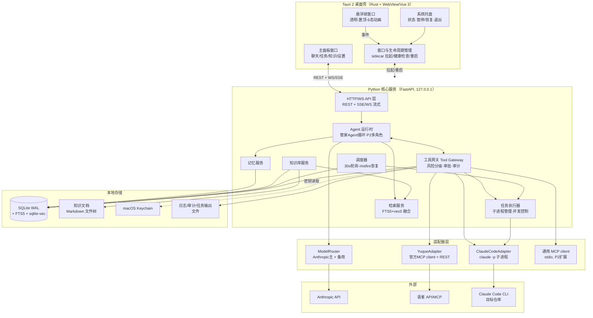
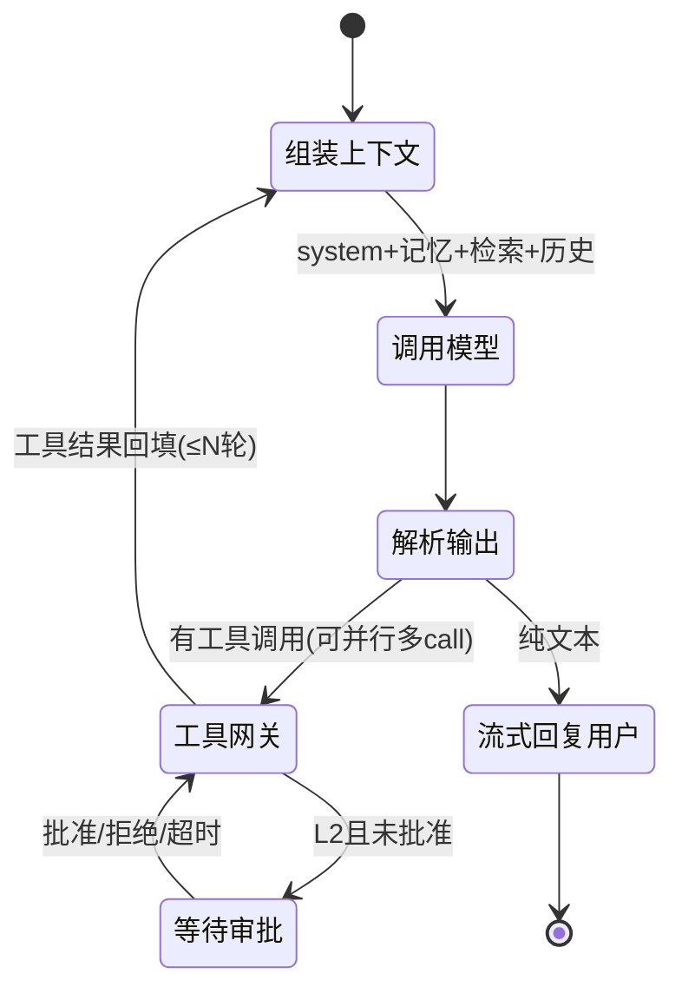
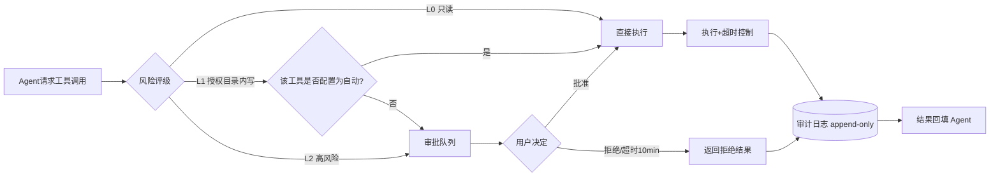
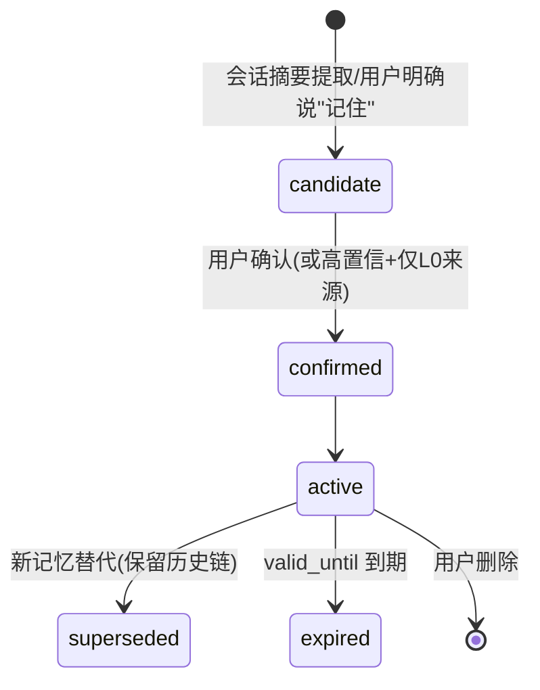
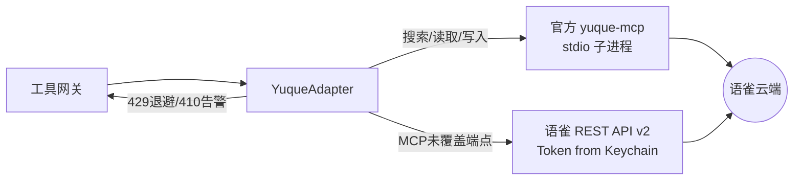
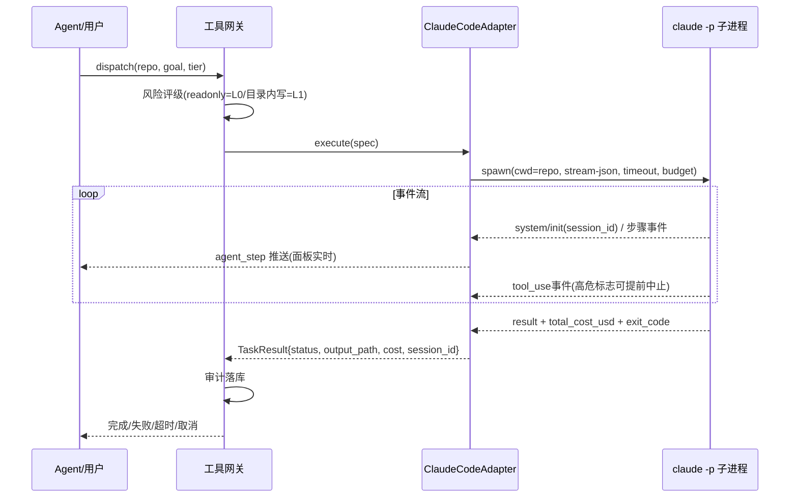
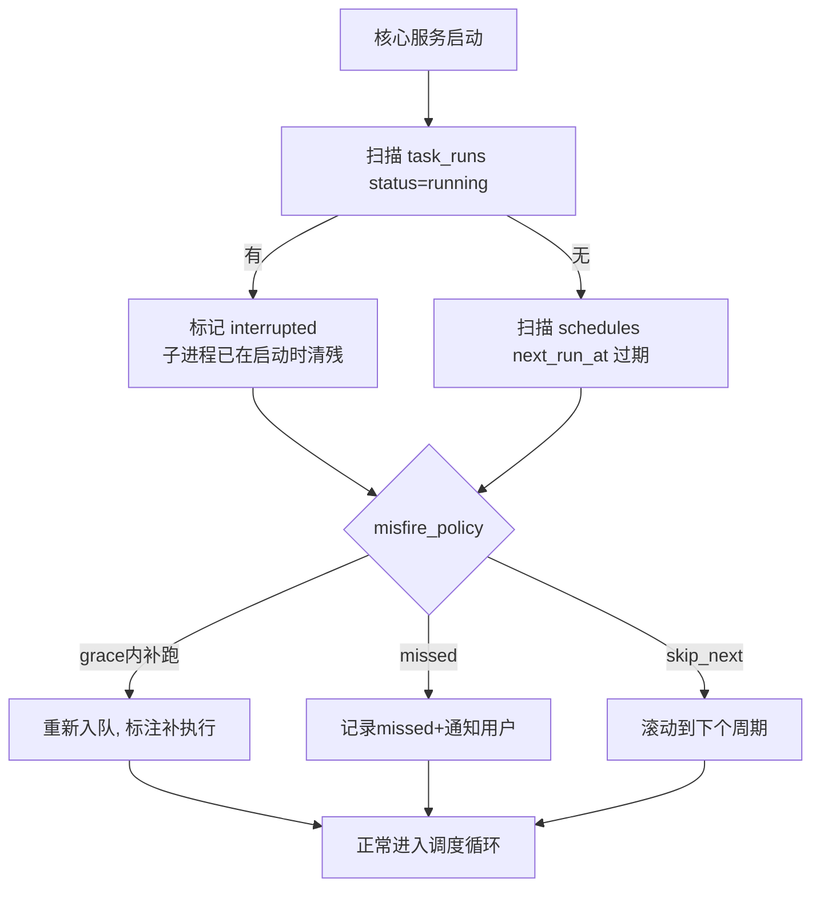
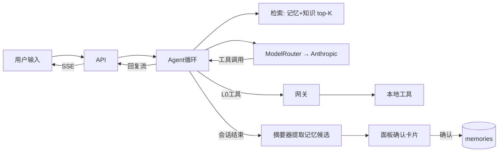
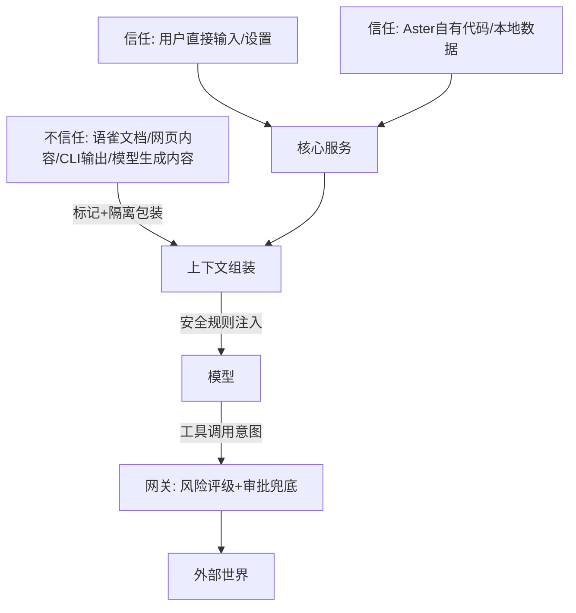

# Aster 系统架构设计

- 版本：v0.1（设计阶段草案）
- 日期：2026-11-03
- 前置阅读：01-PRD、02-技术调研（本文引用其结论编号）
- 标注约定：同 01 文档（【已确认】/【设计建议】/【待验证】）

---

## 1. 总体架构

**【设计建议】两层进程模型**：Tauri 2 桌面壳（UI/托盘/悬浮球）+ Python 核心服务（sidecar 子进程），本机回环通信。



**关键决策与理由：**

| 决策 | 理由 |
|---|---|
| 核心逻辑全在 Python 服务，壳只做 UI | 核心可独立运行（headless 测试/CLI 调试）；UI 崩溃不丢任务 |
| 壳拉起 sidecar 而非 launchd 独立守护 | MVP 简化；"退出应用"语义清晰；P2 可迁 launchd（常驻后台） |
| 回环 REST + WS 而非 IPC | 调试方便（curl 即可测）；SSE/WS 流式现成；安全靠绑定 127.0.0.1 + 启动 token（06 文档） |

---

## 2. 模块职责与依赖关系

| 模块 | 职责 | 依赖 | 不依赖 |
|---|---|---|---|
| 悬浮球/面板（前端） | 渲染与交互；**不做业务决策** | API 层 | 直接碰 DB/文件系统 |
| API 层 | 鉴权（本机 token）、路由、SSE/WS 推送 | 全部服务 | — |
| Agent 运行时 | 上下文组装、模型调用、工具调用解析、多轮循环 | 工具网关、ModelRouter、记忆、检索 | 直接执行工具/IO |
| 工具网关 | 风险评级 → 审批流 → 执行 → 审计落库 | 适配器、审批队列、DB | 模型 |
| 任务执行器 | 子进程生命周期（spawn/超时/取消/并发）、输出落盘 | 适配器 | 模型 |
| 调度器 | 触发计划管理、misfire 恢复、产出任务实例 | DB、任务执行器 | 模型 |
| 记忆服务 | 分类 CRUD、入库确认流、注入候选排序 | DB、（P1）检索服务 | — |
| 知识库服务 | 导入/摘要/打标/去重、Markdown 本体管理 | DB、文件树、ModelRouter | — |
| 检索服务 | BM25 + KNN 双路 + RRF 融合 | DB | — |
| 适配器层 | 外部系统协议封装，**无业务策略** | — | DB（只回传结果） |

依赖方向约束：`UI → API → {Agent, 服务} → {网关, 适配器} → 外部/存储`，禁止反向依赖与跨层调用（如网关不调模型、适配器不写业务表）。

---

## 3. Agent 运行时

### 3.1 单 Agent 主循环（MVP）

**【设计建议】**原生循环，不做框架（02-§4 论证）：



- **轮数上限**（默认 15）与**单任务 token 预算**双保险，超限强制收尾并告知用户；
- 工具结果进上下文前做尺寸裁剪（大输出摘要化，原文落盘引用）——**这是注入防御与上下文预算的交汇点**；
- 每轮循环产出事件（`agent_step`）经 WS 推给面板，过程可见（FR-CHAT-2）。

### 3.2 上下文组装（差异化核心）

```
[system: 管家人设 + 安全规则 + 工具说明]
[活跃记忆: 按相关度×新鲜度 top-K, 预算≤1K token]
[检索注入: 本轮查询相关的知识/历史, 每条带<source>标记]
[会话历史: 滑动窗口, 超窗摘要]
[用户输入]
```

### 3.3 P2 多角色扩展

同进程多 Agent 实例（管家/知识/编程/研究/复核），共享工具网关与审计；管家为编排者，按任务路由子角色。**接口从 MVP 起就按 `AgentConfig{name, role, system_prompt, tools[], model, permissions}` 设计**，避免后期重构。

---

## 4. 工具网关与权限模型

**【设计建议】**所有工具调用（含编程/语雀/本地工具）唯一收口于此：



- **风险评级表**（初始版，可在设置中调整）：

| 级别 | 工具示例 | 默认策略 |
|---|---|---|
| L0 | 本地读文件（白名单内）、检索、任务查询、模型调用 | 自动 |
| L1 | 授权目录内写文件、本地 git 操作、Claude Code 目录内写任务 | 默认确认，可逐工具开"自动" |
| L2 | 语雀创建/更新/删除、目录外写、删除类文件操作、付费 API、任何外部发送 | **必须人工批准，不可配置为自动** |

- 审批请求带完整上下文（参数预览、目标、原因），超时默认拒绝（fail-safe）；
- 全局"紧急停止"开关挂在网关入口：暂停时 L1/L2 全挂起，L0 检索类放行。

---

## 5. 记忆与检索架构

### 5.1 数据分域（严格分表，不混存）

| 域 | 存放 | 特点 |
|---|---|---|
| 个人记忆 | `memories` 表 | 短小、结构化标签、可过期、需出处 |
| 知识库 | Markdown 文件 + `knowledge_docs` 索引 | 长文档、摘要、标签、哈希去重 |
| Skills / Prompts / Agent 配置 | `skills` / `prompts` / `agents` 表 | 版本化管理 |
| 任务记录 | `tasks` / `task_runs` / `tool_calls` | 审计与复盘 |

### 5.2 记忆生命周期



**不做无门槛全量入库**（US-F2）：提取器只产出候选，入库前统一过确认闸。

### 5.3 检索管线

```
query ──┬─ FTS5 BM25(分词列) ──┐
        └─ vec0 KNN(embedding) ┴─ RRF融合 → 按域过滤 → top-N(带source标签)
```

- 记忆注入与知识检索共用管线，`scope` 参数分域；
- embedding 由后台队列异步补算（导入先可搜全文，向量就绪后并路）。

---

## 6. 语雀集成架构

> **状态（2026-11-03）**：官方 MCP/API 需超级会员（用户无），本节方案保留为设计但**默认禁用**，待会员变更后启用；不影响其余架构。



- Token 全程 Keychain 读取，适配器内不缓存明文（进程内短持有）；
- **写入双向闸**：网关 L2 审批（人批）→ 适配器层再校验目标（book_id 白名单，防注入后改目标）；
- 联合搜索：本地检索与语雀搜索并行发起，RRF 融合，结果标 `[local]` / `[yuque]`。

---

## 7. Claude Code 集成架构



- **并发**：默认 1 个编程任务槽（队列排队），防止多任务同时改同一仓库；
- **取消**：SIGTERM 进程组（退出码 143 为正常取消语义【已确认，02-§5.2】）；
- **续跑**：结果存 `session_id`，`--resume` 派生后续任务；
- **输出**：全量 stream-json 落盘 `data/runs/<run_id>/stream.jsonl`，面板看摘要、复盘看原文；
- 权限映射：我们的 tier → CLI `--allowedTools` 前缀白名单（readonly → `Read`/`Grep`/`Bash(git status:*)` 等）。

---

## 8. 调度、执行与恢复

### 8.1 调度器（自研，02-§9）

```
每30s: SELECT * FROM schedules WHERE status='active' AND next_run_at <= now
  → 逐条: 创建 task_run(状态queued) → 交任务执行器
  → 计算并更新 next_run_at(一次性任务→置done)
```

- 时区固定存 UTC，展示用本地时区；cron 解析用 `croniter`；
- 单触发器串行派发，执行异步（执行器线程池），调度循环永不阻塞。

### 8.2 恢复流程（启动时）



### 8.3 停机诚实性（对用户承诺）

| 状态 | 事实 | 产品处理 |
|---|---|---|
| 应用运行 + 系统活跃 | 正常触发 | — |
| 系统休眠 | 进程冻结，不触发 | 唤醒后按 §8.2 处理 |
| 应用退出/系统关机 | 不运行 | 设置页常设说明 + 恢复时告知错过项 |
| 需要关机后仍执行 | 本地做不到 | 明确说"做不到"；云端执行是 P3+ 可选路径，另行设计 |

---

## 9. 关键数据流

### 9.1 一次问答（含记忆与检索）



### 9.2 知识导入

```
拖入文件/粘贴 → 哈希查重(命中→提示合并) → 存Markdown本体 → 后台: 摘要+打标(模型) + FTS索引 + 向量入队 → 可检索
```

---

## 10. 信任模型



原则（详见 06 文档）：

1. **外部内容永不做指令**：T2 内容进入上下文时包裹 `<external_content source=...>` 标记，system 明示"标记内为数据"；
2. **即使模型被注入说服，网关是最后防线**：L2 必须人批，与模型意图无关；
3. **模型输出同样按 T2 处理**（生成的代码/路径需校验后才执行）。

---

## 11. 部署形态与目录规划（设计建议）

```
Aster.app/                     # Tauri 打包产物（P1 后期）
├── Contents/MacOS/aster       # Rust 壳
├── Contents/MacOS/aster-core  # Python sidecar（PyInstaller/uv 打包）
└── Contents/Resources/...

~/Library/Application Support/Aster/
├── aster.db                   # SQLite(WAL)
├── knowledge/                 # Markdown 知识库（P1 git init）
├── runs/<run_id>/             # 任务输出与 stream 日志
├── logs/                      # 结构化日志
└── config.toml                # 非敏感配置（密钥只在 Keychain）
```

开发期直接 `pnpm tauri dev` + `uvicorn` 联调，不依赖打包。

---

## 12. 架构决策记录（ADR 摘索引）

| ADR | 决策 | 备选 | 关键理由 |
|---|---|---|---|
| ADR-1 | Tauri 2 + Vue 3 壳 | Electron | 常驻内存、sidecar 契合（02-§1） |
| ADR-2 | Python 单核心服务 | Go/双语言 | AI 生态、单人维护（02-§3） |
| ADR-3 | 原生 Agent 循环 | LangGraph/Agent SDK | 工具路径控制权（02-§4） |
| ADR-4 | 语雀走官方 MCP + REST 兜底 | 纯 REST/社区 MCP | 官方维护+覆盖度（02-§5.1） |
| ADR-5 | Claude Code 走 CLI 子进程 | 嵌 Agent SDK | 隔离与取消语义（02-§5.2） |
| ADR-6 | SQLite+FTS5+vec0+Markdown 本体 | PostgreSQL | 单机零运维（02-§6） |
| ADR-7 | 自研轮询调度器 | APScheduler | 与状态机耦合、版本过渡期（02-§9） |
| ADR-8 | 回环 REST+WS，token 握手 | Unix socket/直接嵌进程 | 调试与流式（06-§2） |
