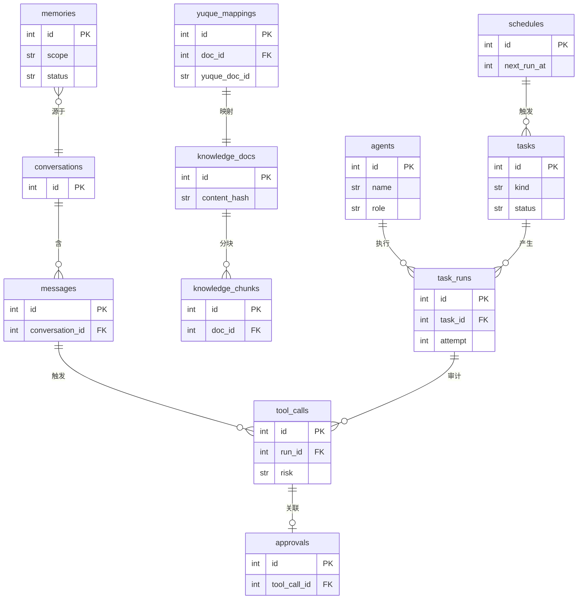
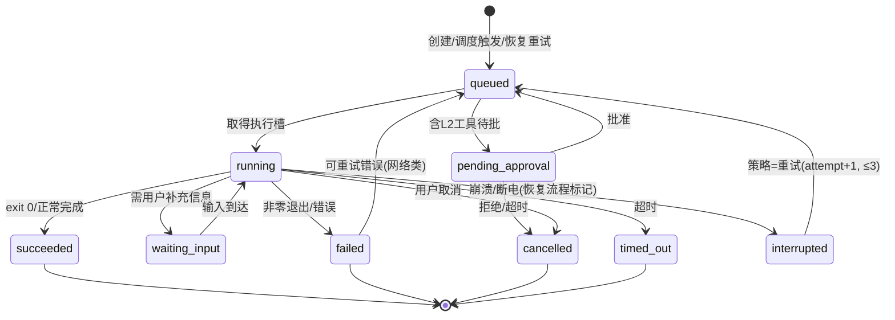

# Aster 数据模型与 API 设计

- 版本：v0.1（设计阶段草案）
- 日期：2026-11-03
- 数据库：SQLite（WAL），UTF-8；时间戳一律 UTC（INTEGER unix 秒），展示层转本地时区
- 标注约定：同前

---

## 1. 实体关系总览



---

## 2. 核心表结构（DDL 草案）

> 主键统一 `INTEGER PRIMARY KEY AUTOINCREMENT`；均含 `created_at`/`updated_at`。以下列出业务字段与关键索引。

### 2.1 会话与消息

```sql
CREATE TABLE conversations (
  id INTEGER PRIMARY KEY AUTOINCREMENT,
  title TEXT,                    -- 首条消息摘要，可编辑
  summary TEXT,                  -- 会话沉淀摘要(P1)
  status TEXT DEFAULT 'active'   -- active | archived
);

CREATE TABLE messages (
  id INTEGER PRIMARY KEY AUTOINCREMENT,
  conversation_id INTEGER NOT NULL REFERENCES conversations(id),
  role TEXT NOT NULL,            -- user | assistant | tool | system
  content TEXT NOT NULL,         -- 正文(工具消息为结构化JSON字符串)
  token_count INTEGER,
  created_at INTEGER NOT NULL
);
CREATE INDEX idx_messages_conv ON messages(conversation_id, id);
```

### 2.2 记忆

```sql
CREATE TABLE memories (
  id INTEGER PRIMARY KEY AUTOINCREMENT,
  scope TEXT NOT NULL,           -- preference | fact | goal | relation | status(临时)
  content TEXT NOT NULL,         -- 记忆正文(一句话)
  tags TEXT,                     -- JSON数组
  source_type TEXT NOT NULL,     -- manual | conversation | import
  source_ref TEXT,               -- 如 conversation:42 / 哈希
  confidence REAL DEFAULT 1.0,   -- 0~1
  status TEXT DEFAULT 'active',  -- active | superseded | expired | deleted
  supersedes_id INTEGER REFERENCES memories(id),  -- 替代链
  valid_until INTEGER,           -- 临时记忆有效期(如出差状态)
  embedding_id INTEGER           -- vec0 关联(P1)
);
CREATE INDEX idx_memories_scope ON memories(scope, status);
```

### 2.3 知识库

```sql
CREATE TABLE knowledge_docs (
  id INTEGER PRIMARY KEY AUTOINCREMENT,
  title TEXT NOT NULL,
  file_path TEXT NOT NULL UNIQUE,   -- Markdown 本体相对路径
  summary TEXT,
  tags TEXT,                        -- JSON数组
  source TEXT,                      -- manual | paste | yuque | web
  source_url TEXT,
  content_hash TEXT NOT NULL,       -- sha256, 去重第一道
  doc_created_at INTEGER, doc_updated_at INTEGER
);
CREATE INDEX idx_kd_hash ON knowledge_docs(content_hash);

CREATE TABLE knowledge_chunks (     -- 分块后入索引
  id INTEGER PRIMARY KEY AUTOINCREMENT,
  doc_id INTEGER NOT NULL REFERENCES knowledge_docs(id),
  chunk_index INTEGER NOT NULL,
  content TEXT NOT NULL,
  fts_indexed_at INTEGER,           -- 全文就绪时间
  embedding_id INTEGER              -- 向量就绪(异步补算)
);
CREATE INDEX idx_kc_doc ON knowledge_chunks(doc_id);

-- FTS5 与 vec0 虚拟表(P1 实装)
CREATE VIRTUAL TABLE knowledge_fts USING fts5(content, content='');
-- CREATE VIRTUAL TABLE knowledge_vec USING vec0(embedding float[1024]);  -- 维度随模型定
```

### 2.4 任务与调度

```sql
CREATE TABLE tasks (
  id INTEGER PRIMARY KEY AUTOINCREMENT,
  kind TEXT NOT NULL,              -- todo | auto
  title TEXT NOT NULL,
  description TEXT,
  status TEXT NOT NULL DEFAULT 'open',  -- 见 §3 状态机
  priority TEXT DEFAULT 'normal',  -- low | normal | high | urgent
  tags TEXT, project TEXT,
  due_at INTEGER,
  schedule_id INTEGER REFERENCES schedules(id),  -- auto 任务绑定
  agent_config TEXT                -- auto任务: AgentConfig JSON(prompt/工具集/权限)
);

CREATE TABLE schedules (
  id INTEGER PRIMARY KEY AUTOINCREMENT,
  task_id INTEGER NOT NULL REFERENCES tasks(id),
  trigger_type TEXT NOT NULL,      -- once | interval | cron
  trigger_expr TEXT,               -- interval秒数 / cron表达式
  next_run_at INTEGER NOT NULL,
  last_run_at INTEGER,
  misfire_policy TEXT DEFAULT 'grace_30m', -- grace_30m | skip | skip_next
  status TEXT DEFAULT 'active'     -- active | paused | done | missed
);
CREATE INDEX idx_sched_due ON schedules(status, next_run_at);

CREATE TABLE task_runs (
  id INTEGER PRIMARY KEY AUTOINCREMENT,
  task_id INTEGER NOT NULL REFERENCES tasks(id),
  agent_name TEXT,                 -- 执行者(P2多Agent)
  status TEXT NOT NULL DEFAULT 'queued',   -- 见 §3
  attempt INTEGER DEFAULT 1,
  trigger TEXT DEFAULT 'manual',   -- manual | schedule | recovery
  started_at INTEGER, finished_at INTEGER,
  exit_code INTEGER, error TEXT,
  output_path TEXT,                -- runs/<run_id>/ 目录
  cost_usd REAL, session_ref TEXT  -- 编程任务: total_cost_usd / claude session_id
);
CREATE INDEX idx_runs_task ON task_runs(task_id, id);
```

### 2.5 工具调用审计与审批

```sql
CREATE TABLE tool_calls (          -- append-only 审计
  id INTEGER PRIMARY KEY AUTOINCREMENT,
  run_id INTEGER,                  -- 关联 task_runs(对话触发可空)
  conversation_id INTEGER,         -- 对话触发时关联
  caller TEXT NOT NULL,            -- agent名
  tool_name TEXT NOT NULL,
  args_digest TEXT NOT NULL,       -- 参数摘要(敏感字段打码)
  risk TEXT NOT NULL,              -- L0 | L1 | L2
  status TEXT NOT NULL,            -- pending | approved | rejected | timeout | success | failed
  result_digest TEXT,
  started_at INTEGER NOT NULL, finished_at INTEGER
);

CREATE TABLE approvals (
  id INTEGER PRIMARY KEY AUTOINCREMENT,
  tool_call_id INTEGER NOT NULL UNIQUE REFERENCES tool_calls(id),
  requested_at INTEGER NOT NULL,
  decided_at INTEGER, decided_by TEXT,  -- user | timeout
  decision TEXT,                        -- approved | rejected
  reason TEXT
);
```

### 2.6 其他配置表

```sql
CREATE TABLE agents (              -- P2 多角色; MVP 一条"管家"记录
  id INTEGER PRIMARY KEY AUTOINCREMENT,
  name TEXT NOT NULL UNIQUE, role TEXT NOT NULL,
  system_prompt TEXT NOT NULL,
  tools TEXT,                      -- JSON数组: 允许工具名
  model TEXT, permissions TEXT     -- JSON: 允许风险级
);

CREATE TABLE skills (
  id INTEGER PRIMARY KEY AUTOINCREMENT,
  name TEXT NOT NULL UNIQUE, description TEXT,
  instructions TEXT NOT NULL, version INTEGER DEFAULT 1,
  enabled INTEGER DEFAULT 1
);

CREATE TABLE prompts (
  id INTEGER PRIMARY KEY AUTOINCREMENT,
  name TEXT NOT NULL UNIQUE, template TEXT NOT NULL,
  variables TEXT                    -- JSON数组: 变量名列表
);

CREATE TABLE yuque_mappings (
  id INTEGER PRIMARY KEY AUTOINCREMENT,
  doc_id INTEGER NOT NULL REFERENCES knowledge_docs(id),
  yuque_doc_id TEXT NOT NULL, yuque_book_id TEXT NOT NULL,
  sync_direction TEXT DEFAULT 'push',  -- push | pull | both (P2)
  last_synced_at INTEGER, last_checksum TEXT,
  UNIQUE(doc_id)
);

CREATE TABLE settings (            -- 非敏感配置; 密钥只在 Keychain
  key TEXT PRIMARY KEY,
  value TEXT NOT NULL              -- JSON标量或对象
);
```

### 2.7 Vec0 表（P1，随 embedding 模型定维度）

```sql
CREATE VIRTUAL TABLE memories_vec USING vec0(docid INTEGER PRIMARY KEY, embedding float[D]);
CREATE VIRTUAL TABLE knowledge_vec USING vec0(docid INTEGER PRIMARY KEY, embedding float[D]);
```

> sqlite-vec pre-v1【已确认 02-§6】：schema 可能变，迁移脚本中集中封装 vec 操作，锁版本。

---

## 3. 任务状态机

`tasks.status`（待办）较简单：`open → done | cancelled`（另有 `overdue` 为查询态非存储态）。

`task_runs.status`（执行实例，含 Agent 任务/编程任务）：



约束：`waiting_input`、`pending_approval` 挂起不占并发槽；重试上限 3 次（指数退避）；`interrupted` 只能由启动恢复流程写入。

---

## 4. API 设计（127.0.0.1 REST + WS/SSE）

约定：前缀 `/api/v1`；JSON；鉴权头 `X-Aster-Token`（启动握手签发，06-§2）；错误统一 `{error: {code, message}}`。

### 4.1 对话

```
POST /api/v1/chat
  {conversation_id?: int, message: string, attachments?: [path]}
  → SSE流: event: token | agent_step | tool_call | tool_result | done | error
  done: {conversation_id, message_id, usage:{input,output,cost_usd}}

GET  /api/v1/conversations?limit=50
GET  /api/v1/conversations/{id}/messages?before=<msg_id>&limit=50
```

### 4.2 任务与调度

```
POST /api/v1/tasks
  {kind:"todo", title:"交报销单", due_at:1762500000, priority:"high", tags:["行政"]}
  → 201 {id: 12, status:"open", ...}

POST /api/v1/tasks            -- 自然语言快速添加
  {kind:"todo", nl:"周五前把报销单交了"}
  → 201 {id:13, parsed:{due_at:..., priority:"normal"}, confirm_hint:"已解析截止:周五"}

PATCH /api/v1/tasks/{id}      {status?:"done", due_at?, priority?, ...}
POST /api/v1/tasks/{id}/remind   {at: unix秒, repeat?: "daily"}  → {schedule_id}

POST /api/v1/tasks            -- 自动任务
  {kind:"auto", title:"每日新闻摘要", schedule:{type:"cron", expr:"0 9 * * *"},
   agent_config:{prompt:"...", tools:["fetch_news","summarize"], max_risk:"L1"}}
  → 201

POST /api/v1/runs/{id}/cancel     → {status:"cancelled"}
POST /api/v1/runs/{id}/retry      → {new_run_id}
GET  /api/v1/runs/{id}            → 详情含 output_path/cost_usd
GET  /api/v1/runs/{id}/stream     → SSE 实时事件(编程任务进度)
```

### 4.3 记忆 / 知识 / 检索

```
GET/POST /api/v1/memories          POST {scope:"preference", content:"...", tags:[...]}
PATCH/DELETE /api/v1/memories/{id} PATCH {status:"expired"}
POST /api/v1/memories/candidates/{id}/confirm | /reject   (确认闸)

POST /api/v1/knowledge/import      multipart 或 {text, title?} → 去重判定 {duplicate_of?}
GET  /api/v1/knowledge?q=&tag=
POST /api/v1/search
  {query:"SQLite 优化", scope:"all|memories|knowledge|yuque", mode:"hybrid", top_k:10}
  → {results:[{source:"local|yuque", ref_id, title, snippet, score, url?}]}
```

### 4.4 语雀 / 编程代理（经网关）

```
POST /api/v1/yuque/search     {q, book_id?} → 联合结果
POST /api/v1/yuque/draft      {title, body_md, book_id}
  → 创建 L2 审批单 {approval_id, preview}   (批准后真正写入)
GET  /api/v1/yuque/status     → 连接状态/Token有效性

POST /api/v1/coding/dispatch
  {repo:"/Users/x/code/foo", goal:"分析架构并输出报告",
   tier:"readonly|write", timeout_s:1800, budget_usd:2.0}
  → 202 {run_id}
GET  /api/v1/coding/runs/{run_id}   → {status, progress:{step, cost_usd}, session_ref}
POST /api/v1/coding/runs/{run_id}/resume  {follow_up:"继续补充测试"} (P2)
```

### 4.5 审批与系统

```
GET  /api/v1/approvals?status=pending
POST /api/v1/approvals/{id}/decide   {decision:"approved|rejected", reason?}

POST /api/v1/system/pause | /resume   (紧急停止/恢复)
GET  /api/v1/system/status            → {core_version, paused, active_runs, db_size, uptime}
GET  /api/v1/audit?tool=&run_id=&limit=   (审计查询)
WS   /api/v1/ws   (面板事件总线: agent_step|approval_requested|task_status|notify)
```

---

## 5. 工具协议（网关层内部接口）

```python
class Tool(Protocol):
    name: str
    risk: Literal["L0", "L1", "L2"]
    schema: dict            # JSON Schema, 供模型 function calling
    async def run(self, args: dict, ctx: RunContext) -> ToolResult: ...

@dataclass
class ToolResult:
    ok: bool
    output: str | dict      # 回填模型(自动裁剪超长)
    artifact_path: str | None = None   # 大输出落盘引用
```

- `RunContext` 携带：run_id/conversation_id/授权目录快照/预算余额/取消事件；
- 每工具实现**必须**只依赖 ctx 提供的能力（不自行读全局密钥/路径）；
- 注册表 `TOOLS: dict[str, Tool]`，Agent 配置按名引用——新增工具零改动网关。

### 5.1 内置工具清单（MVP）

| 工具 | 风险 | 说明 |
|---|---|---|
| memory_search / memory_write(candidate) / memory_read | L0 | 记忆操作(写入走确认闸) |
| knowledge_search / knowledge_read | L0 | 知识检索与读取 |
| task_create / task_query / task_update | L0/L1 | 建待办L0; 改他人任务L1 |
| file_read / file_write / file_list | L0/L1 | 白名单目录; 写为L1 |
| shell_exec | L1/L2 | 白名单目录内命令L1, 否则L2 |
| notify_user | L0 | 本地通知 |
| yuque_search / yuque_read | L0 | 适配器 |
| yuque_create_doc / yuque_update_doc | **L2** | 适配器, 强制审批 |
| coding_dispatch / coding_status / coding_cancel | L0/L1 | readonly=L0, write=L1 |

---

## 6. 适配器接口

```python
class CodingAgentAdapter(Protocol):
    """编程代理适配器 —— 未来可接其他 CLI Agent"""
    name: str
    async def dispatch(self, spec: CodeTaskSpec) -> int: ...          # 返回 run 内部句柄
    async def stream(self, handle) -> AsyncIterator[AgentEvent]: ...  # 统一事件流
    async def cancel(self, handle) -> None: ...                       # SIGTERM 语义
    def parse_result(self, raw) -> TaskResult: ...

class CodeTaskSpec(TypedDict):
    repo: str; goal: str
    tier: Literal["readonly", "write"]
    timeout_s: int; budget_usd: float
    allowed_tools: list[str]     # 由 tier 映射出的 CLI 白名单
```

`YuqueAdapter` 同理：`search/read/create/update` + `health_check()`，实现细节对网关透明。

**ClaudeCodeAdapter 映射表**（tier → CLI 参数）：

| tier | `--allowedTools` | `--permission-mode` |
|---|---|---|
| readonly | `Read` `Grep` `Glob` `Bash(git status:*)` `Bash(git diff:*)` `Bash(git log:*)` | `dontAsk` |
| write | 上述 + `Edit` `Write` `Bash(python -m pytest:*)`（目录 cwd 限定） | `dontAsk` + 目录校验兜底 |

（参数语义【已确认】见 02-§5.2 引用的官方 headless 文档。）

---

## 7. 迁移、版本与日志

### 7.1 Schema 迁移

- `PRAGMA user_version` 存版本号；迁移脚本 `migrations/0001_init.sql` 顺序执行；
- 迁移前自动 `VACUUM INTO` 备份到 `backups/pre_v<N>_<ts>.db`（单用户量小，整库备份成本可忽略）；
- vec0 表由代码集中封装创建（pre-v1 兼容层），schema 变更只动封装层。

### 7.2 日志分层

| 层 | 目的地 | 内容 |
|---|---|---|
| 结构化运行日志 | `logs/aster.log`(滚动) | 模块/级别/事件，密钥全程打码 |
| 审计 | `tool_calls` 表(append-only) | 见 §2.5，UI 可查 |
| 任务原始输出 | `runs/<run_id>/` | stream.jsonl / stdout / 结果文件 |

### 7.3 版本与兼容

- `settings.core_schema_version` + API 前缀 `/v1`；壳与核心服务握手互报版本，不匹配则拒绝启动并提示（避免旧壳配新库）；
- 数据导出：`GET /api/v1/system/export` 打包 db + knowledge/ + config（Markdown 与 SQLite 均开放格式，锁定风险低）。
