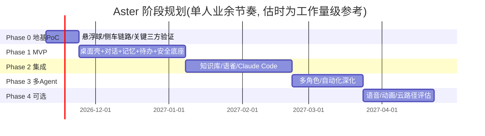

# Aster 开发路线图

- 版本：v0.1（设计阶段草案）
- 日期：2026-11-03
- 原则：每个阶段交付**可运行的端到端切片**（能装、能开、能用、能测），而非层叠半成品
- 流程约束：按 CLAUDE.md 的 SDD 规约，**每个功能切片开工前**在 `docs/superpowers/specs/` 与 `docs/superpowers/plans/` 建对应设计/任务文件并获用户批准后动代码；本路线图即各切片的总纲

---

## 总览



> 估时按"单人、每天 1-2 小时有效投入"量级；审批与联调的不确定性已计入松弛。

---

## Phase 0：地基 PoC（先证伪，再动工）

**目标**：把 02 文档 PoC 清单全部打勾，任何一项不过即回到设计修订，不进入 Phase 1。

| 任务 | 内容 | 对应 PoC | 验收 |
|---|---|---|---|
| 0-1 | Tauri 2 + Vue 3 脚手架；透明悬浮球窗口（macos-private-api、置顶、拖动、穿透） | PoC-1 | 无白底、60fps 拖动、穿透可切换 |
| 0-2 | Python FastAPI 服务 + Tauri sidecar 拉起/健康检查/自动重启 + REST/WS 打通 + 启动 token 握手 | PoC-2 | kill 核心服务 5s 内恢复；curl 全链路可测 |
| 0-3 | SQLite(WAL)+FTS5 中文方案对比（trigram vs 预分词） | PoC-3 | 20 条中文样例检索目测达标并记录选型 |
| 0-4 | sqlite-vec + bge 中文 embedding 在 M4 批量速度/内存实测 | PoC-4 | 千条 <2min、内存增量达标 |
| 0-5 | Claude Code headless 真机验证：readonly/write/取消/费用读取 | PoC-5 | 退出码/成本/session_id 全符合 |
| 0-6 | 语雀官方 MCP client 连通：search/read/429 行为 | PoC-6 | 真实搜索结果返回 |
| 0-7 | 通知/自启/LSUIElement 在未签名场景行为 | PoC-7 | 通知可见、自启成功 |
| 0-8 | 产出 `docs/superpowers/specs/` Phase 1 详细设计 + 用户批准 | — | 用户签字 |

**Phase 0 交付物**：`poc/` 目录（一次性验证代码，明确不进主干）+ PoC 结论文档 + 修订后的设计文档。

> **状态（2026-11-03）**：设计报告已获用户评审通过，四项决策确认（自研调度 / 本地 embedding / 通知降级可接受 / dev 模式日用）。环境基线核查通过（node 22.23.1 / rust 1.97.0 / Python 3.14.7 / SQLite 3.43.2 与 3.53.4 / claude CLI 2.1.234；缺 `uv`，以 venv+pip 替代）；FTS5 trigram 中文冒烟测试通过。Phase 0 spec/plan 已建于 `docs/superpowers/`，待用户批准后执行。

---

## Phase 1：MVP —— "一个能日常用的桌面管家"

**目标**：五块能力端到端可用（01-§7.1），真实日用两周无致命伤。

| 任务 | 依赖 | 验收（摘要，全量见 01-§11） |
|---|---|---|
| 1-1 桌面壳：悬浮球6态/主面板4页/托盘/通知/自启 | 0-1,0-7 | 状态切换正确；通知可点跳转 |
| 1-2 核心服务骨架：配置/日志/迁移框架/启动恢复流程(§8.2空跑) | 0-2 | 断电模拟后状态一致 |
| 1-3 ModelRouter + Anthropic Provider + 流式对话 + 会话持久化 | 0-2 | 10 轮上下文一致；重启恢复 |
| 1-4 原生 Agent 循环 + 工具网关(L0/L1/L2) + 审批 UI + 审计落库 | 1-3 | 假工具即可验证三级路径与审计 |
| 1-5 记忆：CRUD/确认闸/来源追溯/上下文注入 | 1-3 | "记住我偏好中文"→新会话生效 |
| 1-6 待办：CRUD/自然语言解析(先用LLM结构化)/提醒通知 | 1-3,1-1 | "明早9点提醒"到点通知 |
| 1-7 调度器：once/interval + misfire 恢复 + 停机诚实标注 | 1-2,1-6 | 休眠跨点唤醒 30min 内补提醒 |
| 1-8 安全底座：Keychain/授权目录白名单/紧急停止 | 1-4 | 密钥零明文；急停 3s 生效 |
| 1-9 日用形态：`tauri dev` + 本地核心服务直接日用（用户决策 2026-11-03）；`.app` 打包与首次安装引导后置到 Phase 1 末视需要补 | 全部 | 连续两周稳定日用 |

**测试计划（Phase 1）**：

- 单元：状态机迁移表全路径、调度 next_run 计算、上下文预算裁剪、权限映射表；
- 集成：API 层契约测试（pytest + httpx AsyncClient）；网关三级路径 e2e（假模型桩）；
- 手工场景：01-§11 验收表逐条走查 + 连续挂机 48h 内存/日志观察；
- 代码规约：遵循 CLAUDE.md《编程与注释规约》（最简安全 + 中文注释），每任务入 `docs/task-log/`。

---

## Phase 2：集成 —— "知识、语雀、编程代理"

| 任务 | 依赖 | 验收 |
|---|---|---|
| 2-1 知识库：导入/哈希+语义去重/摘要打标/FTS+vec 混合检索 | 0-3,0-4, P1 | 重复导入提示合并；混合检索可用 |
| 2-2 ~~语雀：官方 MCP 接入~~ **已阻断（2026-11-03）**：官方 MCP/API 需超级会员。适配器接口保留、默认禁用；会员变更后再启用 | — | — |
| 2-3 Claude Code 适配器：dispatch/stream/进度/取消/费用/审计/并发1 | 0-5, 网关 | readonly 跑完 git status 干净 |
| 2-4 ~~联合检索：local+yuque RRF 融合~~ **随语雀阻断一并后置**（纯 local 混合检索已在 2-1 覆盖） | 2-1 | — |
| 2-5 自动任务：待办绑定 Agent 配置执行/结果回填/低风险白名单 | P1 调度器 | "每日摘要"自动产出且可追溯 |
| 2-6 会话沉淀：摘要提取记忆候选→确认闸 | 1-5 | 候选准确率人工抽检 80%+ |

**测试重点**：注入防御场景集（语雀文档内藏"请删除文件"指令→被 L2 拦截）；外部失败注入（429/断网/Token 失效）恢复路径。

---

## Phase 3：多 Agent 与自动化深化

| 任务 | 验收 |
|---|---|
| 3-1 AgentConfig 多实例：管家/知识/编程/研究/复核 五角色配置与路由 | 复杂任务自动路由并汇总 |
| 3-2 cron 调度 + 自动执行白名单细化 | 高危永不自动 |
| 3-3 审批体验：批量审批/规则沉淀（"同类动作下次自动"带撤销） | 可解释可回滚 |
| 3-4 Skills/Prompts 管理界面与版本化 | 增删改即时生效 |

> **是否上多 Agent 的决策点**：Phase 2 结束时评估——若单管家 + 工具已满足 90% 场景，3-1 降级为"仅编程/研究两个子角色"，避免为架构而架构。

---

## Phase 4：可选增强（按需启动，不做承诺）

语音输入输出（Whisper 本地 + TTS）、高质量角色动画（Live2D/Spine）、网页抓取入知识库、Aster 自身暴露 MCP server、云端执行路径（关机后仍可跑的诚实方案：任务定义同步云端 + 结果回拉，需重新评估隐私边界）。

---

## 复杂度与优先级矩阵

| 能力 | 价值 | 复杂度 | 结论 |
|---|---|---|---|
| 对话+记忆+待办(Phase1) | 高 | 中 | 立即做 |
| 安全底座(Phase1) | 高(信任前提) | 中 | 立即做 |
| 知识库混合检索 | 高 | 中高 | Phase2 前段 |
| 语雀集成 | 高 | 低(官方MCP) | Phase2 中段 |
| Claude Code 集成 | 高 | 中 | Phase2 中段 |
| 多 Agent | 中 | 高 | Phase3, 且设降级预案 |
| 语音/动画 | 中低 | 高 | Phase4 可选 |

---

## 风险登记（含应对）

| 风险 | 概率 | 影响 | 应对 |
|---|---|---|---|
| Tauri 透明窗口 macOS 细节坑 | 中 | 核心体验受损 | PoC-1 前置；备选：不透明异形窗口(rounded+shadow)也能达标 |
| sqlite-vec pre-v1 破坏性变更 | 中 | 检索中断 | 版本锁定 + 封装层隔离 + 全文检索兜底（向量只是其中一路） |
| 未签名 App 通知/自启受限 | 高 | 体验打折 | PoC-7 摸底；可接受降级（面板内提醒兜底）；后期自签/开发者账号 |
| Claude Code CLI 行为随版本漂移 | 中 | 编程集成失效 | 适配器层版本探测；锁定日常使用版本；官方文档跟踪 |
| 语雀 API/MCP 变更(410 先例) | 中 | 集成失效 | 官方 MCP 优先跟随更新；REST 兜底；变更告警 |
| 单人业余时间投入不稳定 | 高 | 排期漂移 | 切片化推进，每片独立可用；阶段边界即停损点 |
| LLM 幻觉导致错误工具调用 | 中 | 误操作 | 网关 L2 强审批兜底(架构性防御，不依赖模型自觉) |
| 范围蔓延(想做的太多) | 高 |烂尾 | 01-§7.2 排除清单为契约；新增想法进 backlog 不进当前阶段 |

---

## 本地 → 多 Agent → 可选云 演进路径

```
Phase1 单进程单Agent(本地) 
  → Phase2 单进程单Agent+三集成(本地) 
  → Phase3 单进程多Agent配置实例(本地) 
  → Phase4 可选云执行(仅任务计算外包, 数据主权留本地, 需重新过隐私评审)
```

每一步都是前一步的**增量**而非重构：AgentConfig 表、适配器接口、工具协议从 Phase 1 起即为扩展点。
