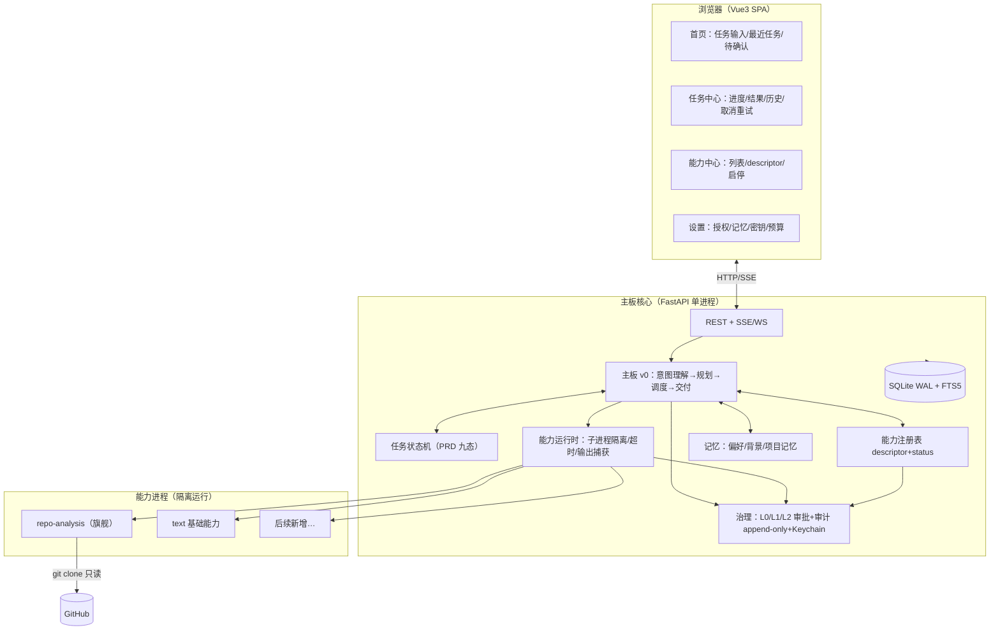

# Aster 平台 Phase 1 设计（自进化智能体平台 · 第一阶段 Spec）

- 日期：2026-11-04
- 需求输入：`product_requirement.md`（PRD V1.0，唯一有效需求源）
- 状态：**待用户批准执行**（含 §10 三个待拍板项）
- 项目转向说明：旧「桌面 AI 管家」方案（docs/01-06 + poc/）整体作废归档，本 spec 为新起点；旧方案中**经过验证的技术事实**直接复用（见 §2）

---

## 1. Phase 1 目标（对齐 PRD 第十九章·第一阶段）

让系统真正可用：统一入口 + 任务管理 + 能力管理的基本闭环。

具体交付（PRD 原文范围）：
1. 首页与主要页面（首页/任务中心/能力中心/设置，四页起步）
2. 自然语言任务输入 → 任务状态展示 → 结果交付
3. 统一能力说明、能力列表、能力状态管理（候选/正式明确区分）
4. **GitHub 仓库链接提交 + 初步项目分析**（Phase 1 的旗舰场景，PRD 场景 B）
5. 任务执行记录、失败说明、恢复操作（取消/重试）
6. 用户授权、基础安全边界、必要审计
7. 基础用户偏好与项目记忆
8. 统一视觉规范（PRD §10.7）

**明确不做**（PRD §19/§20 已划出）：自动发现候选项目、自动接入与构建（Stage 2）、多能力协作编排（Stage 3）、主板进化（Stage 4）、悬浮球/桌面常驻形态、语音。

## 2. 复用的已验证技术事实（来自已归档的 Phase 0 PoC，`archive/poc/README.md`）

（旧产物已归档于 `docs/archive/butler-v1/`，含 poc 结论汇总 `docs/archive/butler-v1/poc/README.md`）

| 事实 | 来源 | 在新架构中的用途 |
|---|---|---|
| 用户 LLM 后端为 GLM（Anthropic 兼容端点，glm-5.3） | PoC-5 | Provider 层全配置化，不假定 Anthropic |
| FTS5 中文定案：jieba 双模式并集 + OR 查询 + BM25（10/10, P@5=0.95） | PoC-3 | 记忆/能力描述检索 |
| torch 基线 441MB | PoC-4 | Phase 1 不上向量检索 |
| 子进程治理语义（SIGTERM→143、try_wait 轮询重启、stdin token 握手） | PoC-2 | 能力运行时（worker 进程隔离） |
| claude headless 七项语义 + 宿主 CLAUDE.md 规则会被继承（须隔离） | PoC-5 | 未来「代码分析工人」接入；Phase 1 仅记录 |
| 自研调度优于 APScheduler（版本过渡期） | 旧 02-§9 | Phase 1 无定时任务，暂不涉及 |

## 3. 产品形态（待拍板 Q1，默认 A）

- **A. 本地 Web 应用（默认建议）**：FastAPI 服务 + Vue3 SPA，浏览器访问 `127.0.0.1:<port>`。理由：PRD 的交互形态全是页面导航型（首页/任务中心/能力中心），无桌面常驻需求；单人开发最快；后续可随时套 Tauri 壳。
- B. Tauri 桌面壳：保留旧方案壳层经验，成本更高，Phase 1 无对应需求。
- C. 纯 CLI + API：最快见内核，但 PRD §10 用户体验是核心产品要求，不建议。

## 4. 总体架构（按形态 A）



关键决策：

| # | 决策 | 理由 |
|---|---|---|
| D1 | 单进程主板 + 子进程 worker（每能力调用独立进程，超时+输出捕获+目录白名单） | PoC-2 验证的进程治理模式；容器化隔离留 Stage 2（接入外部项目时再升级） |
| D2 | 任务状态机采用 PRD §4.4 九态：待处理/规划中/执行中/等待用户确认/验证中/已完成/部分完成/失败/已取消；「取消请求」与「已停止」分离 | PRD 硬性要求（不能提前显示已取消） |
| D3 | 能力 descriptor = PRD §6.4 的 Phase 1 精简版（名称/用途/输入输出/权限/成本/限制/版本/状态），JSON 存储 + FTS5 可检索 | 统一能力描述是平台地基 |
| D4 | 能力状态机：candidate →（评估/批准）→ active → disabled/archived；候选与正式在 UI/调用两侧都严格隔离 | PRD §5.8/§14.1 |
| D5 | 主板 v0 规划器：LLM 意图理解 + 固定任务模板兜底（单能力直跑 / 顺序多步两档）；不做自动并行/评审 | PRD §4.3「不为展示智能而过度拆分」；规划质量是 Stage 3 课题 |
| D6 | 治理复用旧 06 的三级权限模型：L0 只读自动 / L1 白名单内写需确认（可配置自动）/ L2 外部副作用与权限扩张必须人工批准且不可配置自动 | PRD §12.2/12.6 |
| D7 | 记忆 Phase 1 只做三类：用户偏好 / 用户背景 / 项目记忆；确认闸入库 + 来源追溯 + 用户可查改删 | PRD §11.2 七类的最小可用集 |
| D8 | LLM Provider 配置化：默认 GLM 兼容端点（用户现有），Anthropic 为备选项；密钥进 Keychain | PoC-5 环境事实 |
| D9 | GitHub 数据获取：`git clone --depth 1` 到沙箱目录（`data/sandboxes/<task_id>/`）+ 本地分析；**连通性待验证**（Phase 0 时该环境 github 网页抓取被拦，clone 未测过；备选 gh api / 镜像加速） | 新增待验证项，进 1-4 首步 |

## 5. 需求 → Phase 1 落地映射（防走样）

| PRD 模块 | Phase 1 落地 | 后置 |
|---|---|---|
| 主板与任务协调（§4） | 意图理解、简单规划、九态状态机、结果交付、取消/重试 | 动态重规划、并行、失败接管（S3） |
| 开源发现与比较（§5） | 仅场景 B 的人工触发路径：提交链接→初步分析报告（定位/结构/测试/许可/活跃度/风险，区分已验证与推测） | 自动发现/同类比较/评估报告体系（S2） |
| 能力构建与管理（§6） | descriptor、注册表、candidate/active 状态、手动启停 | 自动构建/版本升级/回滚流程（S2） |
| 能力协作（§7） | 顺序多步（模板化）| 并行/评审/候选比较/迭代改进（S3） |
| 反哺与进化（§8/§9） | 数据模型留位（能力经验/故障经验两类记忆表） | 元能力闭环、主板进化（S4） |
| 用户体验（§10） | 四页 + §10.7 视觉基线 + §10.8 易用性验收 | 发现与评估页、成长与进化页（S2/S4） |
| 记忆（§11） | 三类记忆 + 管理要求全量（可查改删/来源/冲突提示） | 任务记忆/能力经验/进化记录（随阶段） |
| 安全治理（§12） | 权限边界/外部内容隔离（repo 内容按数据处理）/审计六类事件 | 供应链深检（S2） |
| 监控恢复（§13） | 执行记录、失败分类（九类先做四类）、按因恢复 | 质量评估体系（S2+） |
| 通知待办（§15） | 应用内待办中心（审批/补信息/失败处理）；系统通知后置 | 通知分级（S2） |
| 数据成果（§16） | 项目/工作空间概念入数据模型；交付物关联任务 | 文件版本管理（S2） |

## 6. 核心数据模型（Phase 1 表，执行期出完整 DDL）

```
tasks(id, goal, plan_json, status∈九态, cancel_requested, project_id, created/updated…)
task_steps(id, task_id, seq, capability_id, input_digest, output_ref, status, started/finished, error)
capabilities(id, name, kind∈六类, descriptor_json, status∈candidate/active/disabled/archived,
             source, version, risk_level, created…)
runs(id, task_id, step_id, capability_id, exit_code, duration_ms, output_path, cost)
tool_calls / approvals（审计与审批，沿用已验证模型）
memories(id, scope∈preference/background/project, content, source_ref, confidence, status)
projects(id, name, description, boundary_paths_json)
settings（非敏感配置；密钥仅 Keychain 引用）
```

## 7. 仓库结构

```
Aster-AI_Assistant/
├── product_requirement.md     # 唯一需求源（PRD V1.0）
├── server/                    # FastAPI 主板核心（Python 包 aster）
├── web/                       # Vue3 SPA
├── capabilities/              # 内置能力的实现（worker 脚本/包）
├── data/                      # 运行数据（ASTER_DATA_DIR 可覆写）：db/ sandboxes/ runs/ logs/
├── docs/                      # 新设计文档 + task-log；旧文档归档至 docs/archive/
└── archive/ 或 docs/archive/  # 旧 butler 方案与 poc（处置方式待拍板 Q3）
```

## 8. 旗舰场景验收（提交 GitHub 链接 → 分析报告）

对任一公开仓库链接：
1. 提交后任务进入「规划中→执行中」，SSE 可见步骤
2. clone 到沙箱（浅克隆），**只读分析**：项目定位（README/文档）、代码结构盘点、测试情况、许可证、活跃度（commit 近况）、明显风险与前置条件
3. 报告明确区分「已验证（来自代码/提交记录）」与「推测（来自项目自述）」——PRD §5.6 证据分级
4. 失败可读（网络不通/仓库不存在/体积超限均有明确原因与建议）
5. 全过程审计可查；clone 属 L0 只读自动放行

## 9. 风险与待验证

| 风险 | 应对 |
|---|---|
| git clone 直连 GitHub 在本环境未验证 | 1-4 首步即测；备选 gh api（已装）/ https.proxy 配置 / 镜像 |
| NL 规划质量不稳 | 固定模板兜底（Phase 1 任务形态有限：分析/文本/查询三类模板） |
| PRD 体量 vs 单人节奏 | 严格按四阶段切片；每片可运行；本 spec 仅锁定 Stage 1 |
| 能力沙箱不足（子进程仍同机） | Phase 1 只跑自研能力 + 浅克隆只读；外部项目接入（S2）时升级隔离 |

## 10. 待用户拍板

- **Q1 产品形态**：A 本地 Web 应用（默认建议）/ B Tauri 桌面壳 / C CLI+API
- **Q2 旧产物处置**：A 归档保留（默认建议，移入 `docs/archive/`）/ B 直接删除（poc 代码 + 旧六文档）
- **Q3 LLM 默认 Provider**：A GLM 兼容端点（默认，复用现有 Key）/ B Anthropic 官方 / C 其他
